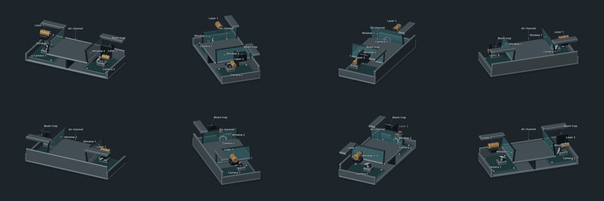

# Wearable air sensor concept

A cohesive source and media repository for an illustrative dual-laser particulate sensor and its proposed watch integration. It contains the accepted 174-second mechanism film, the smooth component-following 32-second tour, the 20-second watch cutaway, editable Blender scenes, and a glTF model for interactive viewers.

**Concept only:** not a calibrated instrument, validated optical simulation, enclosure design, manufacturing specification, patentability assessment, or optical-safety assessment. Colors indicate function rather than wavelength; particles are enlarged. See the [design and scientific limitations](docs/Air_Sensor_Design.md).

## Asset gallery

[](models/Air_Sensor_Latest.glb)

- [Interactive-viewer model (.glb)](models/Air_Sensor_Latest.glb): 51 hardware meshes, two clean-measurement optical paths and 15 illustrative particles
- [Mechanism film, 174 seconds](media/Sensor_Mechanism_Panorama_174s.mp4) · [storyboard](media/film-contact-sheet.jpg) · [captions](source/film/captions.srt)
- [Smooth labeled tour, 32 seconds](media/Sensor_360_Labeled.mp4) · [contact sheet](media/tour-contact-sheet.jpg)
- [Watch cutaway, 20 seconds](media/Watch_Sensor_Zoom.mp4) · [contact sheet](media/watch-contact-sheet.jpg)
- [Sensor scene](models/Sensor_Mechanism_Panorama.blend) · [watch scene](models/Watch_Sensor_Zoom.blend)

The original MP4 bytes are preserved. The original GIFs are included in `media/` for download. The corresponding MP4 loops provide the same presentation with smaller downloads. Both GIFs are also reproducible with the commands below; [release inventory](release/asset-inventory.json) records their checksums and dimensions.

## Quick start

Requires Python 3.11+, Blender **4.3.2**, and FFmpeg/ffprobe with libx264. Designed for macOS and Linux through Python's standard subprocess and pathlib APIs; verified here on Linux. No shell-specific pipeline is required.

```sh
python3 -m venv .venv
. .venv/bin/activate
python -m pip install -r requirements.txt
python tools/project.py validate
python tools/project.py smoke
```

`validate` verifies release hashes, decodes all three MP4s, checks timings and dimensions, and inspects the GLB. `smoke` performs representative real Blender renders for all three pipelines, applies film/tour compositors, verifies watch sensor geometry, and exports/imports the GLB. It is deliberately not a full rerender.

On macOS, if Blender is not on PATH:

```sh
export BLENDER=/Applications/Blender.app/Contents/MacOS/Blender
```

Use `SENSOR_THREADS=4` to control Blender concurrency. All commands work from any current directory when the path to `tools/project.py` is adjusted. Run `python tools/project.py --help` for options.

## Rebuild

```sh
# Film: canonical scene is ready to render; build is only needed after editing its builder.
python tools/project.py render film
python tools/project.py compose film
# Tour: renders 480 native angles, then generates smooth tracked labels.
python tools/project.py render tour
python tools/project.py compose tour
python tools/project.py gif tour
# Watch: canonical scene is ready; build regenerates it from the accepted sensor.
python tools/project.py build watch
python tools/project.py render watch
python tools/project.py compose watch
python tools/project.py gif watch
# Latest static sensor glTF export (interactive when loaded in a viewer).
python tools/project.py export
```

Generated outputs live only under ignored `build/`. For short checks use `render film --indices 0 1008`, `render tour --indices 0 120`, or `render watch --indices 145`. Film/tour indices are zero-based; watch frames are one-based. `--dry-run` prints external commands without executing them, but prepares the staging folder.

Full native renders can take hours and many GB. No frame cache is included. See [pipeline details](docs/WORKFLOWS.md) before editing or rebuilding. Generated results never automatically replace accepted models or media.

## Repository map

- `models/`: one canonical accepted sensor scene, the distinct watch scene, latest GLB
- `media/`: approved MP4s, original GIFs, and compact visual previews
- `source/film/`: captions, and the distinct v3 builder dependency
- `pipelines/`: film, tour, watch and GLB algorithms
- `tools/`: shared staging, CLI, validation
- `assets/fonts/`: one shared Open Sans copy plus notices
- `docs/`: design, reproducibility notes, attribution and viewer guidance
- `release/`: provenance, asset inventory and SHA-256 verification

No website frontend, hosting configuration, account setup, or deployment is included. See [using the GLB on a static site](docs/STATIC_VIEWER.md).

## Rights and publication

No blanket project license has been selected. The owner must choose rights for the original models, media, code, and prose before offering reuse permissions. Bundled fonts have their own licenses. See [LICENSE.md](LICENSE.md) and [third-party notices](docs/THIRD_PARTY_NOTICES.md). This public repository is maintained at https://github.com/KaiyueZou/wearable-air-sensor-project. See [publication audit](docs/PUBLICATION_AUDIT.md) for the metadata cleanup and current verification limits.
